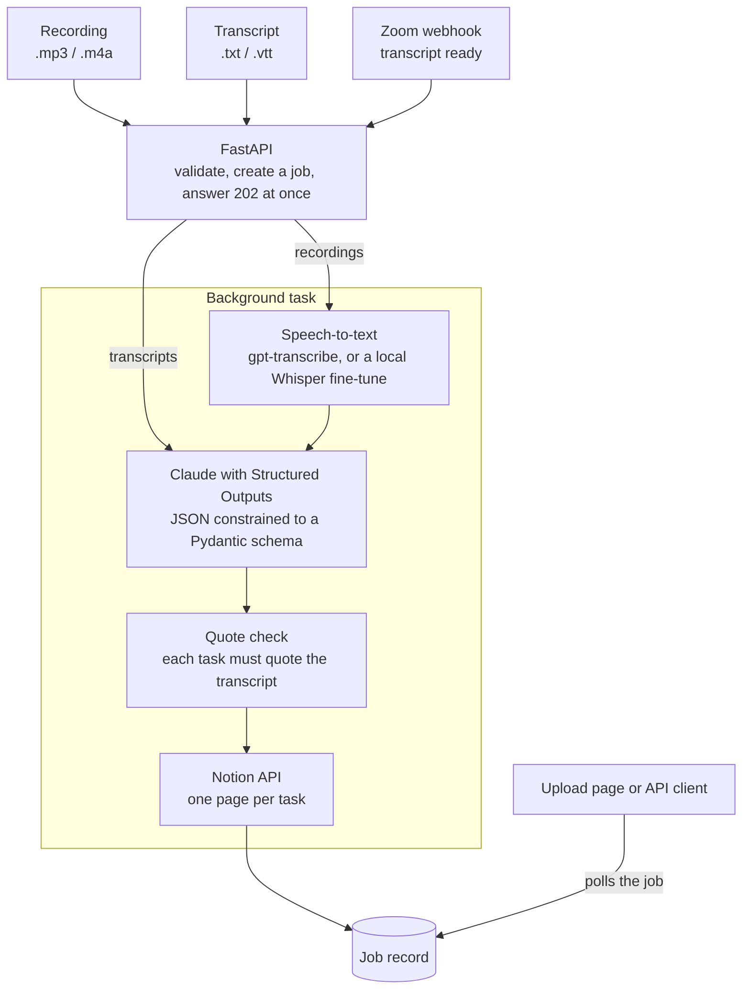
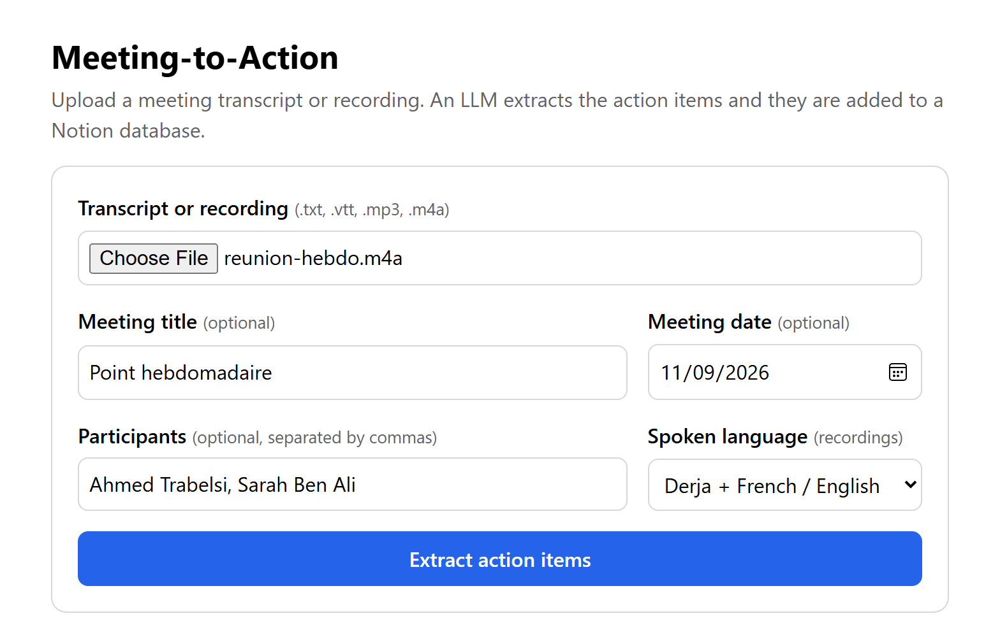

<div align="center">

# Meeting-to-Action

### From *« باش نبعثلك الـ rapport غدوة »* to a Notion task with an owner and a due date.

Upload a meeting recording or transcript. An LLM extracts the action items, checks each one
against what was actually said, and files them in Notion.<br/>
Built for meetings held in **Tunisian Derja, French and English at the same time**.

[](https://github.com/1hamzaachour-ai/meeting-to-action/actions/workflows/ci.yml)


[Why](#-why) · [How it works](#-how-it-works) · [Built for Derja](#-built-for-derja) · [Tech stack](#-tech-stack) · [Getting started](#-getting-started) · [Usage](#-usage)

</div>

---

## 💡 Why

Every meeting ends with the same question a week later: *"wait, who was supposed to do that?"*
Minutes get written late, or never, and the tasks agreed out loud never reach the tracker.

In Tunisia the problem has a second layer. People switch between Derja, French and English
inside a single sentence:

> **باش نبعثلك الـ rapport غدوة، ونعملو réunion أخرى على الـ budget**
> *("I'll send you the report tomorrow, and we'll hold another meeting about the budget")*

Off-the-shelf speech recognition does not survive this. A 2025 study measured stock Whisper
at **50% to over 100% word error rate** on Tunisian speech, while models fine-tuned on it
report far lower error rates (numbers [below](#-built-for-derja)). And once the words are right,
the dialect still sets traps: in Derja, *jem3a* means both "Friday" and "week".

This project is the pipeline I wanted to exist: a recording goes in, and the tasks come out
in Notion, each with its owner, its deadline, and the sentence that proves it was agreed.

## 🔁 How it works



| Step | What happens |
| --- | --- |
| **1. Ingest** | The file is validated (type, size, real content) and a job is registered. The server answers `202 Accepted` in milliseconds; the slow work never blocks a request. |
| **2. Transcribe** | Recordings go through a speech engine that is told which languages to expect and how the participants' names are spelled. |
| **3. Extract** | Claude returns a summary and the action items as JSON. The reply is constrained to a schema generated from a Pydantic model, so it always parses. |
| **4. Verify** | Every task must quote the transcript. The quote is checked character by character; a task whose quote is not there is flagged for review instead of trusted. |
| **5. File** | Each task becomes a Notion page: title, owner, due date, priority, with the context and the quote in the page body. |

## 🇹🇳 Built for Derja

**The problem, in published numbers** (word error rate, lower is better):

| Model | Tunisian speech | Source |
| --- | --- | --- |
| Whisper large-v3, off the shelf | 50% to 94%, depending on the test set | [LinTO, 2025](https://arxiv.org/abs/2504.02604) |
| Whisper large-v3 fine-tuned for Tunisian ↔ French code-switching | 15.2% on the NADI 2026 blind test | [model card](https://huggingface.co/oddadmix/Whisperv3-tunisian-codeswitch) (self-reported) |

These come from different test sets, so they show the size of the gap rather than an exact
ranking. What this project does about it:

- **Two interchangeable speech engines** behind one interface. `gpt-transcribe` (hosted, deploys
  anywhere) is told to expect `ar`, `fr` and `en` together. A Tunisian fine-tune of Whisper can
  run locally on a GPU instead, with one setting: `STT_PROVIDER=local`.
- **Names as hints.** The participants you list are passed to the speech engine, so *Trabelsi*
  is not transcribed three different ways, and to the LLM, so tasks land on the right person.
- **A prompt that knows the dialect.** For Derja recordings the LLM is told how commitments
  and deadlines are really phrased:

  | Heard in the meeting | What the LLM is told |
  | --- | --- |
  | `باش` / *bech*, `لازم` / *lazem*, `تو` / *taw* | Mark a commitment ("going to", "must", "right away") |
  | `إن شاء الله` / *inchallah* after a commitment | Courtesy, not doubt: the commitment stands |
  | `نشوفو` / *nchoufou*, `ممكن` / *momken* | "We'll see", "maybe": not a commitment |
  | `غدوة` / *ghodwa*, `آخر الشهر` | Tomorrow, end of the month: resolved from the meeting date |
  | `الجمعة الجاية` vs `نهار الجمعة` | "Next week" vs "Friday": when unclear, no date is guessed |
  | `رابور`, `ريونيون`, *3asslema* | French in Arabic script and Arabizi are the same language mix |

- **Honest about recognition errors.** The LLM knows the text is machine-made: it assigns an
  owner only when the words make it clear, and leaves a field empty rather than guess.
- **Tasks in the language you work in.** `TASK_LANGUAGE=French` writes the Notion tasks in
  French while the quote stays in the original Derja.

## 🧱 Tech stack

| Layer | Technology | Why this one |
| --- | --- | --- |
| API | **FastAPI** + Uvicorn | Async, `BackgroundTasks` for "answer now, work later", OpenAPI docs for free |
| Contracts | **Pydantic v2** | One model is the validation rule, the JSON schema sent to the LLM, and the API docs |
| LLM | **Claude** (Anthropic API), Structured Outputs | The reply is constrained to the schema; reads Derja, French and English in one pass |
| Speech-to-text, hosted | **OpenAI `gpt-transcribe`** | Accepts several expected languages and keyword hints; replaces `whisper-1`, which OpenAI retires in February 2027 |
| Speech-to-text, local | **Hugging Face Transformers**, Whisper fine-tune, PyAV | Runs a Tunisian model on your own GPU; PyAV decodes audio without a separate FFmpeg install |
| Task tracker | **Notion API** (data sources) | Where the team already tracks work |
| Meetings | **Zoom webhooks** | Transcripts arrive by themselves; requests verified by HMAC-SHA256 signature |
| HTTP client | **httpx2** | One async client and connection pool for Notion, Zoom and speech-to-text |
| Quality | **pytest**, GitHub Actions | The suite runs without network or API keys: external services are replaced by fakes |
| Deployment | Render blueprint, Railway | One process, no database to provision |

## 🚀 Getting started

**Requirements:** Python 3.11 or newer.

```bash
# 1. Clone
git clone https://github.com/1hamzaachour-ai/meeting-to-action.git
cd meeting-to-action

# 2. Create an environment and install
python -m venv .venv
.venv\Scripts\python -m pip install -r requirements-dev.txt     # Windows
# .venv/bin/python -m pip install -r requirements-dev.txt       # macOS / Linux

# 3. Configure
copy .env.example .env                                          # Windows
# cp .env.example .env                                          # macOS / Linux

# 4. Run
.venv\Scripts\python -m uvicorn app.main:app --reload           # Windows
# .venv/bin/python -m uvicorn app.main:app --reload             # macOS / Linux
```

Open **<http://127.0.0.1:8000>** for the upload page, or **<http://127.0.0.1:8000/docs>**
for the interactive API reference.

**What to put in `.env`.** Every integration is optional: the app starts with nothing set
and the page shows what is switched on.

| Variable | Enables | Where to get it |
| --- | --- | --- |
| `ANTHROPIC_API_KEY` | Action-item extraction (**the only one needed to start**) | [platform.claude.com](https://platform.claude.com) |
| `OPENAI_API_KEY` | Uploading recordings (speech-to-text) | [platform.openai.com](https://platform.openai.com) |
| `NOTION_TOKEN` | Writing tasks to Notion | Your Notion integration's secret |
| `NOTION_DATABASE_ID` | Which database to write to | The database's URL, pasted as is |
| `ZOOM_WEBHOOK_SECRET_TOKEN` | The Zoom webhook | Your Zoom app's *Feature* page |
| `API_KEY` | Protects uploads with an `X-API-Key` header | Any long random string (required in production) |
| `TASK_LANGUAGE` | Language of the tasks, e.g. `French` | Your choice |
| `STT_PROVIDER` | `openai` (default) or `local` | See [local speech model](#-setup-guides) |

All settings, with comments, are in [.env.example](.env.example).

## 🎯 Usage

**In the browser:** choose a file, optionally give the meeting date and the participants,
and press *Extract action items*. The tasks appear with their Notion links, followed by the
machine-made transcript so you can judge its quality.

<p align="center">
  
</p>

**From the command line:**

```bash
# A recording (Derja + French/English is the default spoken language)
curl -X POST http://127.0.0.1:8000/api/v1/transcripts \
  -F "file=@reunion.m4a" \
  -F "meeting_date=2026-11-09" \
  -F "participants=Ahmed Trabelsi, Sarah Ben Ali"

# A transcript
curl -X POST http://127.0.0.1:8000/api/v1/transcripts \
  -F "file=@sample_data/sample_transcript.txt" -F "meeting_date=2026-11-09"
```

The answer comes back at once with a job to follow:

```json
{ "job_id": "2d26e8a9…", "status": "queued", "status_url": "/api/v1/jobs/2d26e8a9…", "duplicate": false }
```

`GET` the `status_url` until `status` is `completed`. A result looks like this (shortened):

```json
{
  "status": "completed",
  "media": "audio",
  "result": {
    "meeting_title": "Point hebdomadaire",
    "summary": "L'équipe a fait le point sur le budget et le contrat client…",
    "action_items": [
      {
        "title": "Envoyer le rapport du budget",
        "owner": "Ahmed",
        "due_date": "2026-11-10",
        "priority": "medium",
        "source_quote": "باش نبعثهولك غدوة الصباح إن شاء الله",
        "quote_verified": true
      }
    ],
    "transcription": { "engine": "gpt-transcribe", "languages": ["ar", "fr"], "text": "…" },
    "notion": { "status": "created", "tasks": [{ "title": "Envoyer le rapport du budget", "url": "https://www.notion.so/…" }] }
  }
}
```

| Endpoint | Purpose |
| --- | --- |
| `POST /api/v1/transcripts` | Upload a recording (`.mp3`, `.m4a`) or a transcript (`.txt`, `.vtt`). Form fields: `file`, and optionally `meeting_title`, `meeting_date`, `participants`, `spoken_language` (`derja`, `fr`, `en`, `ar`, `auto`), `force` |
| `GET /api/v1/jobs/{id}` | Status (`queued` → `processing` → `completed` / `failed`), current stage, and result |
| `POST /webhooks/zoom` | Zoom events, verified by signature |
| `GET /health` | Liveness, and which integrations are configured |
| `GET /docs` | Interactive API reference |

## 🛡️ Engineering highlights

| Concern | How it is handled |
| --- | --- |
| Malformed LLM output | Structured Outputs: the model can only answer with JSON matching [the schema](app/schemas/extraction.py) |
| Invented tasks | The quote behind each task is checked against the transcript; unverified items are flagged on the page and in Notion |
| Slow work, short timeouts | `202` plus a job-status endpoint; Zoom gets its answer well inside its 3-second limit |
| Large uploads | Recordings are streamed to disk with a size cap, checked by their first bytes, and deleted as soon as they are transcribed |
| Bursts | At most `MAX_CONCURRENT_JOBS` run at once; the rest wait as `queued` |
| Duplicate tasks | The same file, or the same Zoom meeting delivered twice, returns the existing job; a Notion write is never retried when it may already have gone through |
| Unauthorized use | API key on uploads (mandatory in production), HMAC verification for Zoom, transcript downloads restricted to Zoom's domains |
| Swappable parts | The LLM, the speech engine and the job store each sit behind a small interface |
| Setup mistakes | Each integration is optional, and every failure says what to fix |

## 📚 Setup guides

<details>
<summary><b>Connect Notion</b></summary>

1. Create an internal integration at <https://www.notion.so/profile/integrations> with the
   **Read content** and **Insert content** capabilities. Its secret is `NOTION_TOKEN`.
2. Create a database with these columns (the names can be changed in `.env`):

   | Column | Type | Required |
   | --- | --- | --- |
   | *any name* | Title | yes (every database has one) |
   | `Owner` | Text | yes |
   | `Due` | Date | yes |
   | `Priority` | Select | yes (High, Medium and Low are created automatically) |
   | `Meeting` | Text | no |

3. Open the database, then its `...` menu > **Connections**, and add your integration.
4. Paste the database link into `NOTION_DATABASE_ID`.

At startup the app checks the database and logs exactly what to change if a column is
missing or has the wrong type.
</details>

<details>
<summary><b>Run the Tunisian speech model locally</b></summary>

For the best chance at accurate Derja, run a fine-tuned Whisper on your own machine. A GPU
with about 6 GB of memory should be enough for a large-v3 model in half precision; on a CPU it works
but is slow.

```bash
pip install torch --index-url https://download.pytorch.org/whl/cu126   # or .../whl/cpu
pip install -r requirements-local-stt.txt
```

Then in `.env`:

```ini
STT_PROVIDER=local
LOCAL_STT_MODEL=oddadmix/Whisperv3-tunisian-codeswitch
```

The model is downloaded the first time a recording is uploaded (several gigabytes). Any
Whisper model on Hugging Face works: try `openai/whisper-tiny` first to check the setup in
seconds. Check a model's license on its card before using it commercially.
</details>

<details>
<summary><b>Connect Zoom</b></summary>

Zoom sends the `recording.transcript_completed` event for accounts with cloud recording and
audio transcription (Zoom lists Business, Education and Enterprise plans).

1. In the [Zoom App Marketplace](https://marketplace.zoom.us), build a **Server-to-Server OAuth** app.
2. Add the scope `cloud_recording:read:recording:admin`.
3. On the **Feature** page, copy the **Secret Token** into `ZOOM_WEBHOOK_SECRET_TOKEN`, then
   deploy the app so it has a public URL.
4. Enable **Event Subscriptions**, set the endpoint URL to `https://<your-app>/webhooks/zoom`,
   click **Validate**, and subscribe to *Recording > Recording transcript files have completed*.

No Zoom account? The webhook can be tested with correctly signed requests:

```bash
python scripts/send_zoom_test_event.py --secret <your secret token> --validation
```
</details>

<details>
<summary><b>Deploy</b></summary>

The app is one process with no database. Run a single worker: jobs are kept in memory.

**Render.** In Render choose *New > Blueprint* and select the repository.
[render.yaml](render.yaml) defines the service; Render asks for the secrets and generates
`API_KEY`. The free plan stops after 15 idle minutes and takes about a minute to wake up,
which is longer than Zoom waits, so use a paid instance for the webhook.

**Railway.** Create a project from the repository. Railpack takes the Python version from
`.python-version` and the start command from [railpack.json](railpack.json). Add the
variables above plus `ENVIRONMENT=production`, set the health check path to `/health`, and
generate a domain.

Hosted speech-to-text works on any plan. The local speech model needs a GPU machine.
</details>

## ✅ Tests

```bash
python -m pytest
```

The suite needs no network and no API keys. The real Anthropic SDK and HTTP client are used,
while the servers behind them (Anthropic, OpenAI, Notion, Zoom) are replaced by in-memory
fakes that follow the published API formats. GitHub Actions runs it on Python 3.11 and 3.14 on every push.

## 🗂️ Repository structure

```text
meeting-to-action/
├── app/
│   ├── main.py                    # app factory: builds clients and the pipeline at startup
│   ├── config.py                  # settings, read from the environment / .env
│   ├── errors.py                  # errors whose message is safe to show a user
│   ├── logging_config.py
│   ├── middleware.py              # request-size ceiling
│   ├── api/
│   │   ├── deps.py                # shared dependencies, API-key check
│   │   └── routes/
│   │       ├── transcripts.py     # POST /api/v1/transcripts  (recordings and transcripts)
│   │       ├── jobs.py            # GET  /api/v1/jobs/{id}
│   │       ├── zoom.py            # POST /webhooks/zoom
│   │       ├── health.py          # GET  /health
│   │       └── ui.py              # GET  /
│   ├── schemas/
│   │   ├── extraction.py          # what the LLM must return (the Structured Outputs schema)
│   │   ├── transcription.py       # speech-to-text request and result
│   │   ├── jobs.py                # job record and API shapes
│   │   └── zoom.py                # Zoom webhook payloads
│   ├── services/
│   │   ├── pipeline.py            # the background job: transcribe → extract → verify → Notion
│   │   ├── transcription.py       # speech engine interface + hosted client (OpenAI API)
│   │   ├── local_whisper.py       # speech engine: a Hugging Face model on this machine
│   │   ├── audio.py               # safe handling of uploaded recordings
│   │   ├── extraction.py          # prompts (incl. Derja guidance), LLM interface, quote check
│   │   ├── anthropic_extractor.py # the Claude call
│   │   ├── notion.py              # column check, page mapping, retries
│   │   ├── zoom.py                # signature check, transcript download
│   │   ├── job_store.py           # job records, behind an interface
│   │   └── transcripts.py         # decoding text, converting .vtt
│   └── static/index.html          # upload page
├── tests/                         # pytest suite and the fakes it uses
├── scripts/send_zoom_test_event.py
├── sample_data/                   # sample transcripts (.txt, .vtt)
├── docs/upload-page.png           # screenshot used in this README
├── .github/workflows/ci.yml       # tests on Python 3.11 and 3.14 on every push
├── .env.example                   # every setting, documented
├── .gitignore · .gitattributes
├── requirements.txt               # runtime dependencies, pinned
├── requirements-dev.txt           # + pytest
├── requirements-local-stt.txt     # optional: local speech model
├── render.yaml · railpack.json · .python-version   # deployment
├── LICENSE                        # MIT
└── README.md
```

## 🧭 Limits and roadmap

- **Recordings up to 25 MB** with the hosted engine (about 100 minutes of mono audio at
  32 kbps). Next: split longer files automatically.
- **No speaker labels from audio.** Owners come from what is said; listing the participants
  helps. Next: speaker diarization.
- **Derja accuracy is not yet measured here.** Next: an evaluation script that scores each
  speech engine against a reference transcript.
- **Jobs live in memory.** They are lost on restart. `JobStore` is an interface, ready for a
  Redis or Postgres implementation, and `BackgroundTasks` can give way to a real queue.

---

<div align="center">

Built by **Hamza Achour** · [GitHub](https://github.com/1hamzaachour-ai)

</div>
